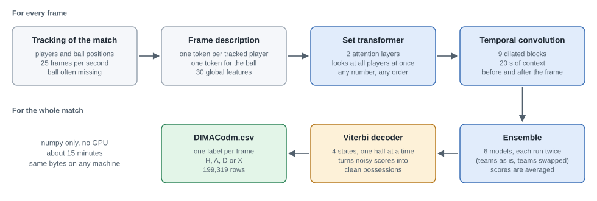

# DIMACodm: frame-level ball possession

Submission of team **DIMACodm** to More than a Hack 2027, Phase 1 (Ball Possession).

Team: Ali Anass Amradouch, Mehdi Berrada, Adnane El Yazid.

Given the automatic tracking of FC Barcelona vs Athletic Club, the code writes one label per frame
of the tactical video:

| label | meaning |
|---|---|
| `H` | the home team has the ball |
| `A` | the away team has the ball |
| `D` | dead ball |
| `X` | outside the graded halves |

The ranking metric is spellF1.

## Where to find what

| you want | go to |
|---|---|
| the method, the training data, the possession rules, the limitations | [docs/TECHNICAL_DOCUMENT.md](docs/TECHNICAL_DOCUMENT.md) |
| to regenerate the submission file | [Regenerate the submission file](#regenerate-the-submission-file), below |
| how the weights were trained | [docs/TRAINING.md](docs/TRAINING.md) |
| the fingerprint of the submitted file | [final/SUBMISSION.json](final/SUBMISSION.json) |

## The method in short



- **A set transformer** reads, for every frame, the tracked players and the ball as a set of
  tokens: any number of players, in any order.
- **A temporal convolution** gives each frame 20 seconds of context before and after.
- **An ensemble of six models** scores every frame: home or away, dead or alive, change of team.
- **A four-state Viterbi decoder** turns these scores into clean possessions.
- **Training uses only public data about other games.** Their clean tracking is degraded on the
  fly so that it looks like an automatic tracking.
- **Inference is plain numpy in float64.** No GPU is needed and the output is byte-identical from
  one machine to the next.

## Regenerate the submission file

Requirements: [uv](https://docs.astral.sh/uv/) and the data bundle of the competition. No GPU.
About 15 minutes per run on a 4-core laptop.

```bash
git clone https://github.com/aliamrrr/dimacodm-mtah2027-possession.git
cd dimacodm-mtah2027-possession
uv sync --locked                       # Python 3.11 and the pinned dependencies (uv.lock)
```

Unpack the bundle into `data/` (layout in [data/README.md](data/README.md)), or point
`MTAH_DATA_DIR` at it. Then:

```bash
uv run mtah data check                 # files present, alignment, figures published in DATA.md
uv run mtah data check-loader          # our loader rebuilds the four official baselines byte for byte
uv run mtah final dimacodm             # writes final/DIMACodm.csv
```

`mtah final` runs the solution twice (tracking cache on, then off), requires the two files to be
byte-identical, passes the result through the official `validate_submission.py`, and prints its
sha256. The value to compare with is in [final/SUBMISSION.json](final/SUBMISSION.json).

For a single run with its score on the public 5 minutes (a pipeline check, never a tuning set):

```bash
uv run mtah run dimacodm               # writes submissions/dimacodm/<run>/submission.csv
uv run mtah official-board             # the organisers' own run_evaluation.py on that file
uv run mtah reproduce submissions/dimacodm/latest/manifest.json
```

Without the data, the whole pipeline can be tried on a synthetic match generated from a seed:

```bash
uv run mtah synthetic --mini
uv run mtah run dimacodm --data-dir data_synthetic
```

## Tests

```bash
uv run pytest                          # about 20 minutes: includes a full-length synthetic match
uv run pytest -k "not slow and not contract and not end_to_end"     # about 2 minutes
```

The tests cover the tracking parser, the official scorer and validator (called unmodified), the
equality of `dummy` with the official baselines, determinism of every solution, the label
derivation on the other games, the tracking degradation, and the equality of the numpy inference
with the training code.

## Layout

```
configs/dimacodm.yaml        parameters of the submitted solution
src/mtah/
  cli.py                     the `mtah` command
  pipeline.py                run, validate, score, manifest; reproduce; final
  data/                      loaders: tracking (ATD), Smart Tagging, homography
  solutions/dimacodm/        the solution
    deep_solution.py           inference on a match (entry point of `dimacodm`)
    deep_features.py           per-frame tokens and global features
    deep_net.py                the network in numpy (inference)
    model.py                   the Viterbi decoder
    deep_model.py              the network in torch (training only)
    deep_data.py               tracking degradation, training samples
    deep_train.py              training, 5 folds by game + 1 on all games
    deep_tune.py               decoder parameters, out-of-fold
    bench.py                   download of the other games, labels, benchmark bundles
    train_gpu.sh               the training recipe, end to end
  solutions/dummy/           the official baseline, re-implemented (loader check)
  synthetic/                 generator of a fake match in the official formats (tests)
models/dimacodm/             the six trained models, pinned by sha256
vendor/official/             exact copy of the organisers' scorer, validator and documentation
scripts/make_figures.py      writes the figures of the documentation
tests/
docs/                        technical document, training notes, figures
```

## Rules

- The labels come out of the code in this repository. Nothing was annotated or corrected by hand.
- No model was trained or tuned on the provided match. Training data, model selection and decoder
  parameters all come from public data about other games (docs/TECHNICAL_DOCUMENT.md, section 3).
- The public 5 minutes were used to check the pipeline, as EVALUATION.md describes, and to check
  our reading of the possession definition, as CHALLENGE.md asks. No parameter was fitted on them.
- No data of the match is in this repository.

## Licence

MIT, see [LICENSE](LICENSE). `vendor/official/` is a copy of the organisers' repository under its
own licence. The data sources of the training games keep their own licences (docs/TRAINING.md).
