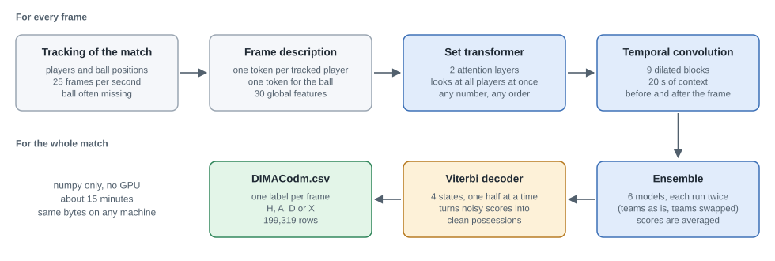
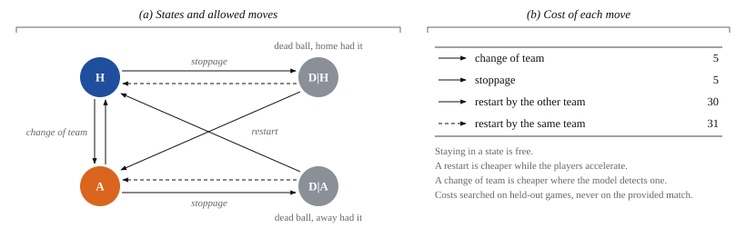
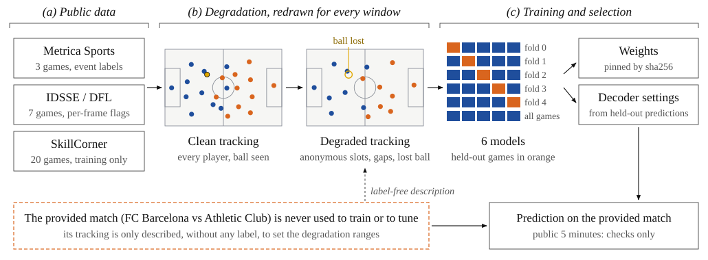

# Frame-level ball possession: technical document

More than a Hack 2027, Phase 1: Ball Possession.

**Team DIMACodm**: Ali Anass Amradouch, Mehdi Berrada, Adnane El Yazid.

Repository: https://github.com/aliamrrr/dimacodm-mtah2027-possession

## Summary

- **Task.** For every frame of the tactical video, say which team has the ball (`H` or `A`) or
  that the ball is dead (`D`).
- **Model.** A neural network reads the players and the ball in each frame, with 20 seconds of
  context before and after. A small decoder then turns its per-frame scores into clean
  possessions.
- **Training data.** Public data about 30 other games. Nothing was trained, fitted or calibrated
  on the ground truth or on the video of the provided match.
- **Result on other games.** spellF1 of 0.752 on ten games the models never saw.
- **Reproduction.** One command, no GPU, about 15 minutes per run, the same file on any machine.

## 1. Approach

### What matters

The ranking metric, spellF1, matches whole possessions by how much they overlap in time. What
counts is where each possession starts and stops, not how many frames are right.

The rules forbid training or tuning on the provided match. We therefore train and select
everything on other games. The hard part becomes making those other games look like the automatic
tracking of the provided match (section 3).

### The pipeline



*Figure 1. Architecture. (a) Each frame is read as an unordered set of objects. (b) The sequence of
frame vectors is read with 20 s of context on each side; the drawing shows the first four of the
nine dilations. (c) The state and team-change outputs feed a Viterbi decoder; the ball position
and possessor heads are used in training only. The drawing is schematic.*

1. **Frame description.** Each tracked player and the ball become one token: position, velocity,
   team, and position and speed relative to the ball. Thirty global features complete the frame,
   for example how fast the players move, whether the ball is beyond a line, and how many players
   are off the pitch.
2. **Set transformer, per frame.** Two attention layers (64 dimensions, 4 heads) look at all the
   players at once. Track slots are anonymous and their number changes, so the model works on a
   set: any number of players, in any order.
3. **Temporal convolution, across time.** Nine dilated blocks give every frame 20 seconds of
   context on each side. This is what lets the model follow a possession while the ball is lost.
4. **Outputs.** The model answers two questions per frame: which team controls the ball, and is
   the ball dead. A third output marks the frames where the team changes; the decoder uses it.
   Two more are used only during training to shape the model: the ball position and the player
   in possession.
5. **Ensemble.** Six models are averaged. Each one runs twice, once as is and once with the two
   teams swapped, so the result treats both teams exactly the same way.
6. **Decoder.** A Viterbi decoder turns the noisy per-frame scores into possessions.

### The decoder



*Figure 2. The decoder. (a) The four states and the moves between them. (b) What each move costs.*

The decoder has four states. It remembers which team had the ball before a stoppage. Staying in a
state is free and every move has a cost, so it only changes state when the evidence is strong and
lasts. Two costs move with the play: a restart is cheaper while the players accelerate, and a
change of team is cheaper where the model detects one. Each half is decoded on its own.

### Two choices that follow from the metric

- **Loss.** spellF1 counts each possession once, whatever its length. A plain per-frame loss would
  let long possessions dominate. Each frame is therefore weighted by
  (duration of its possession) ^ -0.5, with a floor at 0.5 s.
- **Determinism.** Inference is plain numpy in float64 and the decoder inputs are rounded to 1e-4.
  The same file comes out on any machine.

### Why this rather than something simpler

We first built a logistic model on hand-made distance features with the same decoder. It is kept
in the repository as `dimacodm_logistic`. It reaches 0.46 on our first benchmark, against 0.75 for
the deep model. Possession depends on where all the players are and on what happens seconds
before and after. Per-frame distances to the ball do not capture that.

## 2. Assets used

| asset | used | how, or why not |
|---|---|---|
| tactical tracking (ATD) | yes | positions of the players and of the ball, team of each slot |
| ATD speed column, third ball field | no | everything is recomputed from positions, so the same code runs on the other games |
| Smart Tagging | no | it has no equivalent on the other games, so its use could not be validated |
| homography | no | not needed to decide possession |
| tactical video | no | the tracking was enough for this approach |
| broadcast video and tracking | no | not synchronised with the tactical video |
| public ground truth (5 minutes) | checks only | see section 5 |

## 3. Training data

None of it comes from the provided match. We labelled nothing by hand. All labels come from the
publishers of the data.



*Figure 3. Training. (a) The three public sources. (b) Their clean tracking is degraded at random
for every training window. (c) Six models are trained; each benchmark game is scored by a model
that never saw it. The published weights and decoder settings then predict the provided match.*

| source | games | tracking | labels, and who made them |
|---|---|---|---|
| Metrica Sports sample data (github.com/metrica-sports/sample-data, commit `e706dd5`) | 3 | 25 fps | events annotated by Metrica. Per-frame H / A / D derived mechanically from the events (`bench.derive_labels`) |
| IDSSE / DFL (Bassek et al., Scientific Data 2025, CC-BY 4.0, doi 10.6084/m9.figshare.28196177) | 7 | 25 fps | `BallStatus` and `BallPossession` on every frame, from the DFL's quality-controlled tracking. This is how the challenge describes its own ground truth |
| SkillCorner open data (github.com/SkillCorner/opendata, MIT, commit `4340d27`) | 20 | 10 fps, resampled to 25 | team in possession per phase of play, by SkillCorner. Training only. Its stoppage frames are never a target |

Every file is downloaded by the code and checked against a pinned hash.

**Benchmark.** The ten Metrica and DFL games are also our benchmark. Each one is only ever scored
by a model that did not see it (five folds by game).

**Label conventions.** Each source labels possession in its own way. The model learns one
embedding per source. We predict with the DFL one, because CHALLENGE.md describes the ground truth
as built the same way.

### Making clean tracking look automatic

The other games come with clean tracking. The provided match comes with automatic tracking: slots
are anonymous, the ball is often lost. A model trained on clean tracking would fail on it. So
every training window is degraded at random:

- anonymous slots that follow a player for 8 s to 200 s, with gaps, identity changes and
  duplicates;
- position noise from none to 40 cm;
- episodes where a large part of the players is not tracked;
- a ball missing 25 % to 55 % of the time, in runs of 0.6 s to 30 s;
- a ball that keeps moving during stoppages.

The code is in `deep_data.py`.

**How the ranges were set.** We described the tracking of the provided match without any label,
in coarse bins only: how smooth positions are, how long the ball stays visible or missing, how
long a slot follows a player, how many objects are tracked, whether a visible ball is ever still.
RULES.md allows inspecting the data to design features. No label, frame or value of the match is
used, and no model is fitted on it. The description uses the automatic tracking only, which is the
input of the algorithm: no ground truth and no video. The models are then trained, and the decoder
is tuned, on the other games alone. The degradation ranges cover what this description shows:

| | automatic tracking of the match | degradation used in training |
|---|---|---|
| position jitter | under 0.5 cm | none to 40 cm |
| ball seen or missing, in runs of | 10 to 30 s | 0.6 to 30 s |
| a slot follows a player for | 1 to 3 min | 8 s to 200 s |
| frames with fewer than 16 objects tracked | 5 to 15 % | episodes where many players are untracked |
| ball visible but still | 5 to 15 % of the frames with a ball | ball kept moving in 70 % of the stoppages |

The last line is the important one. In the source data a dead ball lies still or is hidden. In an
automatic tracking it is visible and moving. A model trained only on the former takes such
stoppages for play. On the other games, with the ball moving in 70 % of the stoppages (it glides
to the restart spot, wanders, is carried, or is passed between players), such a model finds 72 %
of the dead-ball frames. Trained with moving dead balls, it finds 98 %.

## 4. Possession rules implemented

| situation | what the system does |
|---|---|
| any graded frame | always `H`, `A` or `D`. No abstention. `X` is written only outside the two halves, whose limits come from the official `games.py` |
| ball not tracked | possession carries on. The model infers the team from the players and from the last and next sightings within its 20 s of context |
| loose or contested ball | possession stays with the team that had it. Changing team has a cost in the decoder, paid only by sustained evidence for the other team |
| brief possession | kept (see below) |
| stoppage | detected from the players (collective slowing, kick-off formation, players off the pitch) and from the ball beyond a line. The model is trained not to rely on a ball that stops moving |
| restart | the decoder remembers which team had the ball before the stoppage. A restart by the same team costs slightly more than one by the other team |
| dead ball | always `D`. Who owns the dead ball is not asked for |
| half-time | the halves are decoded separately, nothing carries over. The frames graded before the second-half kick-off are labelled `D` by the model itself. No frame number is written in the code |

**Brief possessions.** CHALLENGE.md says that the public ground truth wins over any reading of the
definition, and it contains short possessions. We therefore apply no minimum duration
(`min_spell_s: 0`). This is a reading of the definition, not a fitted value: the organisers allow
inspecting the data to understand what counts as possession, and zero means that no duration rule
is applied at all.

## 5. Results and checks

### On other games

Ten games, each predicted by a model that never saw it. Tracking degraded to be as close as we
could make it to an automatic one. Mean of the per-source means, labels as published.

| | spellF1 | dead-ball frames found |
|---|---|---|
| model trained without moving dead balls | 0.641 | 72 % |
| final model, same decoder | 0.725 | 98 % |
| final model, decoder searched on held-out predictions | **0.752** (Metrica 0.780, DFL 0.723) | |

Per game, the final system scores between 0.66 and 0.80. The decoder parameters were searched by
coordinate ascent on these held-out predictions (`deep_tune.py`). For reference, the published
floor of the organisers' baseline is 0.243 on the provided match.

### On the provided match

Automatic checks only. Nothing was trained, fitted or calibrated on the ground-truth possession
data or on the video of the provided match. The model weights come from the other games, and the
decoder parameters were searched on them.

- `mtah data check-loader`: our loader rebuilds the four official baselines byte for byte.
- The frames graded before the second-half kick-off, which FAQ.md says are all dead ball, are all
  `D` in our file.
- On the public 5 minutes, as the official README suggests ("compare the poss and dur columns"):
  19 possessions against 17 in the ground truth, mean duration 12.8 s against 14.2 s. The four
  stoppages start and end within one second of the truth, except two boundaries within three.
  spellF1 on this window is 0.77. With 17 possessions it carries little information.
- `mtah final` produces the same bytes twice, with and without the tracking cache.

## 6. Limitations

- **Short possessions.** Possessions under 2 s are the hard part. Fewer than half are recovered on
  the other games, and each one missed also damages the possession it interrupts.
- **Simulated benchmark.** Our benchmark simulates automatic tracking. The simulation may still
  differ from the real tracking, so the score on other games is an estimate, not a measurement, of
  the score on the provided match.
- **Long ball losses.** With the ball untracked for tens of seconds, the team in possession is
  inferred from the players alone. A change of possession inside such a stretch can be missed.
- **Label convention.** We assume the provided match is labelled like the training games
  (possession changes at every touch). The public window is consistent with it, on 17 possessions.
- **Training is not bit-reproducible** on a GPU. The published weights are pinned by hash, and the
  prediction from them is bit-reproducible.

**With more time** we would use the Smart Tagging and the video, which are unused today. Both
could help with restarts and with the lost ball. We would also work on the short possessions,
which cost the most.

## 7. Reproduction

```bash
git clone https://github.com/aliamrrr/dimacodm-mtah2027-possession.git
cd dimacodm-mtah2027-possession
uv sync --locked
# unpack the data bundle into data/, or set MTAH_DATA_DIR
uv run mtah data check-loader
uv run mtah final dimacodm          # writes final/DIMACodm.csv
```

Compare the sha256 that `mtah final` prints with the one in `final/SUBMISSION.json`.

Python 3.11 and every dependency are pinned in `uv.lock`. No GPU is needed. `mtah final` runs the
solution twice, about 15 minutes each on a 4-core laptop, and checks that both runs give the same
bytes. Training is described in docs/TRAINING.md.
